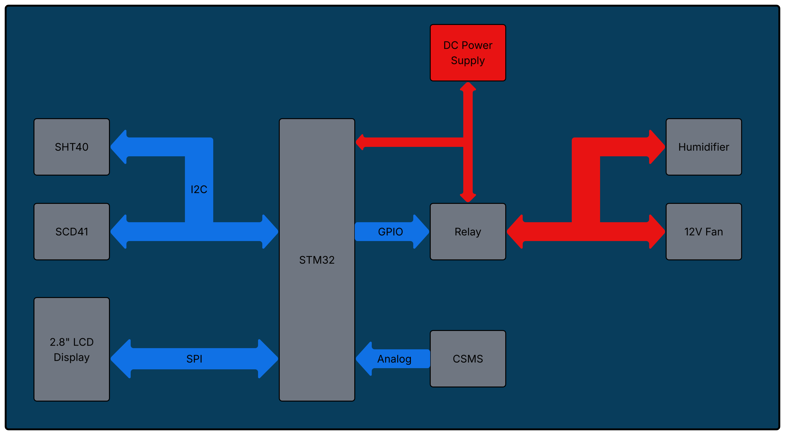

## Overview

The goal of this project is to design and implement an autonomous plant growth chamber, targeted specifically at Mycelium cultivation. Successful mycelium colonization and fruiting require tightly regulated environmental parameters that change across distinct growth stages. This system provides a fully autonomous closed loop environment. It monitors ambient temperature, humidity, substrate moisture, and carbon dioxide $CO_2$ levels, dynamically driving actuators for fans, foggers and heaters to maintain an optimal environment. Users can inspect telemetry and adjust target states locally via an interactive touch screen interface.

## Detailed Component & Materials

The central processing system will use the STM32L476 Microcontroller to handle timing, sensor polling, control algorithms, and communication with the display.

To monitor the temperature and relative humidity inside the chamber, we will use the Sensirion SHT40. We will also use the Sensirion SCD41 to monitor carbon dioxide levels inside the chamber. A Capacitive soil moisture sensor will be used to monitor soil moisture.

To display data and receive user commands, we will use the Nextion HMI touch display. This is a touch screen display capable of displaying live graphs, sensor readings, and receiving environmental configuration commands.

To isolate low voltage microcontroller logic from high voltage 12V DC and 120V AC power systems, a 4 channel 5V optoisolated relay module will be used. Connected to this module will be a 12V waterproof brushless fan to drive fresh air in and out of the chamber. An ultrasonic fogger will also be attached to maintain high humidity during the fruiting stages of growth. A 12V Silicone Heating Pad will be attached to the actuator as well to provide necessary heat to the system. To provide the high voltage needed to power the system, a standard 12V power supply will be used.

## System Architecture

The system is divided into three section, the processing core, the sensor input layer, and the power switched actuation layer.

## Functional Specifications & Control Logic

1. Humidity Control Loop

   The SHT40 continuously polls relative humidity. If the humidity drops below the user defined threshold on the touch screen, the microcontroller asserts a GPIO pin driving a relay to pulse the ultrasonic fogger until the target humidity is reached.

2. $CO_2$ Regulation

   During colonization, $CO_2$ is permitted to accumulate. During the fruiting stage, the SCD41 triggers an interrupt driven or polled check. If $CO_2$ exceeds a defined threshold, the 12V exhaust fan runs for a calculated duration to cycle fresh air into the chamber.

3. Safety And Fault Detection

   A thermal watchdog routine monitors core temperatures via the SHT40. If ambient temperature exceeds 30deg centigrade, the system cuts all heating elements, forces maximum exhaust fan speed, and flags a visual warning on the touch screen. Likewise, if temperature drops below 20deg centigrade then the heating pad will be activated. Hysteresis will be accounted for to prevent toggle between nominal and off nominal states.
