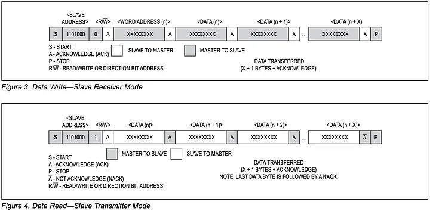

# Software Design Document (SDD) for I2CDriver

## Setting up I2C

To use I2C on stm32l476, we need to configure a few things before we can even send data. This involves the following:

1. Enabling the system clock that we are going to use (HSI16)
2. Configuring I2C to use the system clock
3. Enable GPIOB (pins 8 and 9 are SCL and SDA respectively) and enable I2C clock
4. Configure GPIOB pins 8 and 9 to be alternate functions, with alternate function defined as I2C, to use open-drain configuration, and to have internal pull up resistors enabled.
5. Configure I2C timing (see below)

## I2C Timing Fields (page 1324 in reference manual)

| Bitfield | Bits      | Width  | Purpose                                                                    |
| -------- | --------- | ------ | -------------------------------------------------------------------------- |
| `PRESC`  | `[31:28]` | 4 bits | Prescaler: Divides the I2C peripheral clock to create the base tick period |
| `SCLDEL` | `[23:20]` | 4 bits | Data Setup Time: Delay between SDA edge and SCL rising edge                |
| `SDADEL` | `[19:16]` | 4 bits | Data Hold Time: Delay between SCL falling edge and SDA edge                |
| `SCLH`   | `[15:8]`  | 8 bits | SCL High Period: How long the clock stays high                             |
| `SCLL`   | `[7:0]`   | 8 bits | SCL Low Period: How long the clock stays low                               |

What we need to know in order to configure these fields correctly are:

1. The clock frequency feeding the I2C peripheral (HSI16)
2. Target I2C speed (100 kHz for standard, 400 kHz for fast, ...)
3. Rise and Fall times. These are determined by the pull up resistors and bus capacitance.

Example: Let's figure out `TIMINGR` for a standard (100kHz) peripheral assuming a clock speed of 16 MHz.

1. Choose `PRESC`:
   - We want a prescaled clock tick that is convenient to divide down to 100kHz.
     $$t_{PRESC}=(PRESC + 1) \times t_{I2CCLK}$$
   - Since 16 MHz has a period of 62.5 ns, we divide by 4 to get 250ns.
   - Because the hardware adds 1, set `PRESC=3`
2. Calculate `SDADEL` (Data hold time):
   - I2C standard mode requires a minimum data hold timme, and `SDADEL` must account for fall time and internal sync delays. In the reference manual, they give a formula:
     $$SDADEL \ge \frac{t_{HD;DAT(min)}+t_f - t_{AF(min)} - 3 \times t_{I2CCLK}}{t_{PRESC}}$$
   - For 100 kHz, $t_{HD;DAT(min)}=0 ns$. Even with $t_f=100ns$, the numerator is small or negative, meaning `0` is technically valid, though setting `SDADEL=2` is safe.

3. Calculate `SCLDEL` (Data setup time)
   - I2C standard mode requires SDA to be stable for at least $t_{SU;DAT(min)}=250ns$ beforee SCL rises, plus the rise time $t_r$:
     $$SCLDEL \ge \frac{t_r + t_{SU;DAT(min)}}{t_{PRESC}} - 1$$
   - Using $t_r = 100 ns$ and $t_{SU;DAT}=250ns$:
     $$SCLDEL \ge \frac{350 ns}{250 ns} - 1 = 0.4 \approx 1$$

4. Calculate `SCLL` and `SCLH` (clock low and high periods)
   - For 100 kHz, the total clock period is $10 \mu s$.
   - with $t_{PRESC}=250 ns$, we need a total of $\frac{10 \mu s}{250 ns}=40 $ ticks per clock cycle.
   - I2C standard mode requires $t_{LOW}\ge 4.7 \mu s$ and $t_high \ge 4.0 \mu s$.
   - split the 40 ticks across the rise and fall times:
     $$SCLL=0x13 (19)\implies (19 + 1) * 250ns = 5 \mu s$$
     $$SCLH=0x0F (15)\implies (15 + 1) * 250ns = 4 \mu s$$

5. Write the C code to do this

```C
I2C1->CR1 &= ~I2C_CR1_PE; // disable I2C1 before configuring timing

I2C1->TIMINGR = (0x3 << I2C_TIMINGR_PRESC_POSITION)  |
                (0x4 << I2C_TIMINGR_SCLDEL_POSITION) |
                (0x2 << I2C_TIMINGR_SCADEL_POSITION) |
                (0x0FU << I2C_TIMINGR_SCLH_POSITION) |
                (0x13U << I2C_TIMINGR_SCLL_POSITION);

I2C1->CR1 |= I2C_CR1_PE; // Enable I2C1
```

**NOTE**: Page 1290 on RM0351 document has timing configurations for common modes.

## Reading/Writing Sequence


